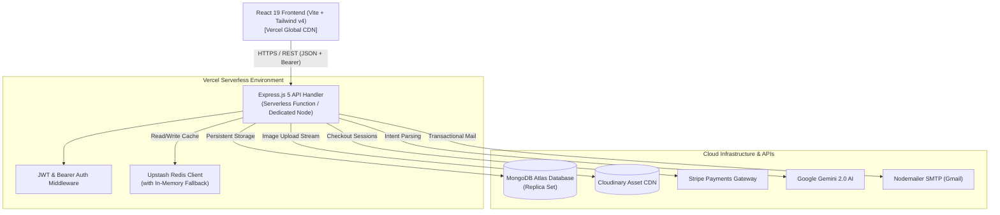

<div align="center">

# 🛒 E-Mart — Full-Stack AI-Powered E-Commerce Platform

**A modern, production-grade E-Commerce web application featuring semantic search powered by Google Gemini AI, blazing-fast Redis caching, secure Stripe checkout, and role-based administration.**

[](https://e-commerce-websitefronted.vercel.app/)
[](https://e-commerce-websitebackened.vercel.app/)
[](https://opensource.org/licenses/ISC)

<br/>

[](https://react.dev/)
[](https://vitejs.dev/)
[](https://tailwindcss.com/)
[](https://nodejs.org/)
[](https://expressjs.com/)
[](https://www.mongodb.com/atlas)
[](https://upstash.com/)
[](https://ai.google.dev/)
[](https://stripe.com/)
[](https://cloudinary.com/)

</div>

---

## 📌 Table of Contents
- [Project Overview](#-project-overview)
- [Key Features](#-key-features)
- [System Architecture](#-system-architecture)
- [Tech Stack](#-tech-stack)
- [Repository Structure](#-repository-structure)
- [Database Models](#-database-models)
- [API Documentation](#-api-documentation)
- [Environment Variables](#-environment-variables)
- [Getting Started (Local Development)](#-getting-started-local-development)
- [Deployment Guide (Vercel)](#-deployment-guide-vercel)
- [Security & Performance Engineering](#-security--performance-engineering)
- [Author & Acknowledgments](#-author--acknowledgments)

---

## 🌟 Project Overview

**E-Mart** is a comprehensive full-stack e-commerce solution architected with modern industry standards. It bridges high-converting storefront experiences with robust back-office management, enterprise caching, generative AI capabilities, and secure financial processing.

### Why This Project Stands Out:
- **Natural Language Shopping**: Utilizes Google's `gemini-2.0-flash-lite` LLM to parse natural, conversational user queries into targeted product categories and search parameters.
- **Enterprise Caching Pipeline**: High-throughput distributed caching using **Upstash Redis** with an intelligent automatic in-memory fallback mechanism to guarantee 0% downtime and ultra-fast page speeds.
- **Bulletproof Cross-Domain Auth**: Implements a hybrid authentication pattern combining `HttpOnly` secure cookies with `Authorization: Bearer` token fallback, completely bypassing third-party cookie restrictions across modern browsers.
- **Micro-App Monorepo**: Decoupled client (`fronted`) and server (`backened`) architecture pre-configured for both standalone long-running environments and Vercel Serverless Functions.

---

## 🚀 Key Features

### 🛍️ Customer Storefront & Catalog
- **Interactive Product Catalog**: Grid and list views with responsive layouts built on Tailwind CSS v4 and Radix UI.
- **Multi-Faceted Filtering & Sorting**: Filter by category, price ranges, search query, and pagination with instant URL parameter synchronization.
- **Featured Products Showcase**: Curated carousel and showcase grids for highlighted seasonal merchandise.
- **Individual Product Deep-Dives**: Detailed descriptions, high-resolution media galleries, stock status, and related recommendations.

### 🤖 AI-Powered Smart Search
- **Intent Extraction with Gemini AI**: Users can type colloquial queries like *"show me warm clothes for snow"* and the AI agent automatically extracts the intent to map to the `Jacket` category.
- **Graceful Query Fallback**: If LLM quota or connection is unavailable, queries gracefully cascade to standard indexed multi-field regex matching.

### 🛒 Cart & Checkout Workflow
- **Persistent Cart State**: Cart data persists in MongoDB for authenticated accounts and syncs seamlessly across devices.
- **Dynamic Quantity Control**: Real-time increment, decrement, and line-item removals with automatic subtotal and tax computations.
- **Stripe Checkout Integration**: Seamless, PCI-compliant payment flow generating one-time hosted Stripe checkout sessions.
- **Order Confirmation & Verification**: Post-payment webhook verification with automated order generation in the database.

### 📊 Admin Control Center & Analytics
- **Live Sales & Revenue Metrics**: Interactive charting powered by **Recharts** visualizing daily transaction volume and revenue curves.
- **Product Lifecycle Management**: Create, view, update, toggle `featured` status, and delete inventory with atomic database actions.
- **Cloudinary Image Asset Pipeline**: Multer-backed binary upload stream directly converting product media into optimized WebP formats on Cloudinary CDN.
- **Customer Intelligence**: Monitor registered customer counts, order frequency, and newsletter subscriber lists.

### 💬 Social Proof & Feedback
- **Review & Rating System**: Customers can submit verified ratings (1–5 stars) and detailed textual reviews.
- **Helpful Vote Aggregator**: Community-driven feedback ranking allowing shoppers to upvote useful reviews.

### ✉️ Marketing & Notifications
- **Newsletter Engine**: One-click subscription capturing prospect emails for campaigns.
- **Transactional Password Resets**: Cryptographically signed password-recovery tokens delivered via Nodemailer SMTP with HTML templates.

---

## 🏗️ System Architecture



---

## 💻 Tech Stack

### Frontend
| Technology | Description |
| :--- | :--- |
| **React 19** | Latest generation React UI library utilizing concurrent features |
| **Vite 8** | High-performance ES-module build tool with instant HMR |
| **Tailwind CSS v4** | Next-generation CSS framework with `@tailwindcss/vite` |
| **TanStack React Query v5** | Server-state caching, background synchronization, and optimistic UI |
| **Zustand** | Minimalist, unopinionated client store for user and session state |
| **React Router 7** | Client-side routing with lazy-loaded code-splitting |
| **Lucide React** | Consistent, lightweight SVG icon package |
| **Sonner** | Modern, performant stacked toast notifications |
| **Recharts** | Declarative charting library for analytical data visualization |

### Backend
| Technology | Description |
| :--- | :--- |
| **Node.js 22+** | Server-side JavaScript runtime configured in ECMAScript Modules (`"type": "module"`) |
| **Express.js 5** | High-speed, minimalist web application framework |
| **MongoDB & Mongoose 9** | Object Data Modeling (ODM) with strict schema validation and query helpers |
| **Upstash Redis** | Serverless Redis instance for HTTP-based distributed caching |
| **Google Generative AI** | Official SDK for Gemini 2.0 Flash Lite intent extraction |
| **Stripe Node SDK** | Server-side payment processing and checkout session generation |
| **Cloudinary SDK** | Automated cloud asset storage, transformation, and CDN delivery |
| **Bcrypt.js & JWT** | Secure cryptographic password hashing and JSON Web Token signature |
| **Nodemailer** | SMTP email client for transactional communications |

---

## 📂 Repository Structure

```text
E-Commerce-website/
├── .gitignore                   # Multi-package ignore rules
├── README.md                    # Root project documentation
├── info.txt                     # Architecture notes and roadmap
│
├── fronted/                     # React 19 Frontend Application
│   ├── public/                  # Static assets (favicons, banners)
│   ├── src/
│   │   ├── assets/              # Static media and API services
│   │   │   └── Api/             # Axios request abstraction layers (user, product, cart, etc.)
│   │   ├── components/          # Reusable UI widgets, Navbar, Footer, Review components
│   │   │   └── ui/              # Radix UI primitives and custom inputs
│   │   ├── hooks/               # Custom React Query mutation and query hooks
│   │   ├── lib/                 # Utility helper functions
│   │   ├── Pages/               # Route views
│   │   │   ├── Admin/           # Dashboard, AnalyticDashboard, ProductDashboard
│   │   │   ├── Auth/            # Login, Register, ForgotPassword, ResetPassword
│   │   │   └── User/            # Home, Product, SingleProduct, CartPage, Profile, Purchase
│   │   ├── Routes/              # Route definitions & ProtectedRoute guards
│   │   ├── store/               # Zustand state stores
│   │   ├── App.jsx              # Root component wrapper
│   │   └── main.jsx             # React entrypoint & Axios interceptor configuration
│   ├── .env.example             # Frontend environment blueprint
│   ├── package.json             # Frontend dependencies & scripts
│   ├── vercel.json              # Vercel Single-Page App (SPA) rewrite rules
│   └── vite.config.js           # Vite build pipeline and path alias settings
│
└── backened/                    # Node.js Express REST API
    ├── src/
    │   ├── config/              # Environment parser, DB connector, Cloudinary, Email setup
    │   ├── controller/          # Business logic handlers (user, product, cart, payment, analytics)
    │   ├── middleware/          # JWT authentication, RBAC admin guards, Multer image upload
    │   ├── model/               # Mongoose schemas (User, Product, Order, Review, Newsletter)
    │   └── routes/              # Express API route declarations
    ├── .env.example             # Backend environment blueprint
    ├── index.js                 # Express server bootstrap with serverless export
    ├── package.json             # Backend dependencies & scripts
    ├── seed.js                  # Automated database seeding utility with Faker
    └── vercel.json              # Vercel Serverless Function build configuration
```

---

## 🗄️ Database Models

### 1. `User` Schema
- **name**: `String` (Required, Trimmed)
- **email**: `String` (Required, Unique, Lowercase)
- **password**: `String` (Hashed via bcrypt)
- **owner**: `Boolean` (Default: `false` — automatically elevated for `ADMIN_EMAIL`)
- **profilePhoto**: `String` (Cloudinary URL)
- **cartItem**: Array of references to `CartItem` (Product reference + quantity)
- **resetPasswordToken**: `String` (Crypto SHA-256 hash)
- **resetPasswordExpireAt**: `Date`

### 2. `Product` Schema
- **name**: `String` (Required)
- **description**: `String` (Required)
- **price**: `Number` (Required, min: 0)
- **image**: `String` (Cloudinary URL)
- **category**: `String` (Enum: `Jeans`, `Pants`, `Shirt`, `Jacket`, `Saree`, `Shoes`, `Womens`, `Kids`, etc.)
- **isFeatured**: `Boolean` (Default: `false`)

### 3. `Order` Schema
- **user**: `ObjectId` (Ref: `User`)
- **products**: Array of `{ product: ObjectId, quantity: Number, price: Number }`
- **totalAmount**: `Number`
- **stripeSessionId**: `String`
- **status**: `String` (`pending`, `completed`, `failed`)

### 4. `Review` Schema
- **user**: `ObjectId` (Ref: `User`)
- **name**: `String` (Display author)
- **rating**: `Number` (1 to 5)
- **comment**: `String`
- **helpfulCount**: `Number` (Default: 0)

### 5. `Newsletter` Schema
- **email**: `String` (Required, Unique, Lowercase)
- **subscribedAt**: `Date`

---

## 🔌 API Documentation

All backend endpoints are prefixed with `/api`.

### 🔐 Authentication & Profile (`/api`)
| Method | Endpoint | Access | Description |
| :--- | :--- | :--- | :--- |
| `POST` | `/register` | Public | Register new customer account |
| `POST` | `/login` | Public | Authenticate user & return JWT + cookie |
| `POST` | `/logout` | Authenticated | Revoke session & clear cookies |
| `POST` | `/forgot-password`| Public | Generate and send password reset link |
| `POST` | `/reset-password/:token` | Public | Set new password via token |
| `GET` | `/getUser` | Authenticated | Fetch current authenticated user profile |
| `POST` | `/updateProfile` | Authenticated | Update user name and avatar via Multer |
| `GET` | `/getCartItem` | Authenticated | Retrieve customer's persistent cart items |

### 📦 Products (`/api/product`)
| Method | Endpoint | Access | Description |
| :--- | :--- | :--- | :--- |
| `GET` | `/getAllProduct` | Public | Filtered, paginated product catalog with Gemini AI search |
| `GET` | `/getFeaturedProduct`| Public | Retrieve featured showcase products |
| `GET` | `/getSingleProduct/:id` | Public | Fetch specific product details |
| `POST` | `/createProduct` | Admin Only | Upload image to Cloudinary and insert new item |
| `POST` | `/toggleProduct/:id` | Admin Only | Toggle product's featured status |
| `POST` | `/deleteProduct/:id` | Admin Only | Remove product and invalidate cache |

### 🛒 Shopping Cart (`/api/cart`)
| Method | Endpoint | Access | Description |
| :--- | :--- | :--- | :--- |
| `POST` | `/addToCart` | Authenticated | Add product or increment quantity in user cart |
| `POST` | `/removeFromCart` | Authenticated | Decrement item quantity or remove item from cart |
| `POST` | `/removeAll` | Authenticated | Flush all items from user's shopping cart |
| `POST` | `/updateQuantity/:id` | Authenticated | Explicitly set quantity for a line item |

### 💳 Payments (`/api/payment`)
| Method | Endpoint | Access | Description |
| :--- | :--- | :--- | :--- |
| `POST` | `/createPayment` | Authenticated | Create hosted Stripe Checkout Session |
| `POST` | `/create-success` | Public | Verify session completion & create Order |

### 📈 Analytics (`/api/analytic`)
| Method | Endpoint | Access | Description |
| :--- | :--- | :--- | :--- |
| `GET` | `/getDate` / `/getData` | Admin Only | Aggregate total users, products, sales, and revenue |
| `GET` | `/dailySales` | Admin Only | Retrieve daily aggregated sales for Recharts |

### 💬 Reviews & Newsletter (`/api/review`, `/api/newsletter`)
| Method | Endpoint | Access | Description |
| :--- | :--- | :--- | :--- |
| `GET` | `/review/all` | Public | Fetch verified customer testimonials |
| `POST` | `/review/create` | Public/Auth | Submit a star rating and comment |
| `POST` | `/review/helpful/:id` | Public | Increment helpfulness vote on review |
| `POST` | `/newsletter/subscribe` | Public | Subscribe email to mailing list |
| `GET` | `/newsletter/subscribers` | Admin Only | View subscriber list |

---

## 🔐 Environment Variables

### Frontend (`fronted/.env`)
Create a `.env` file in the `fronted/` directory:

```env
# URL to your deployed or local backend API (must include /api and no trailing slash)
VITE_BASE_URL=https://your-backend-app.vercel.app/api
```

### Backend (`backened/.env`)
Create a `.env` file in the `backened/` directory:

```env
# Application Port & Mode
PORT=5001
NODE_ENV=production

# MongoDB Atlas Database
MONGO_URI=mongodb+srv://<username>:<password>@cluster0.xxxxx.mongodb.net/ecommerce?retryWrites=true&w=majority

# JSON Web Token Secret
JWT_TOKEN=super_secret_jwt_signature_key

# Admin User Designation
ADMIN_EMAIL=admin@emart.com

# Frontend Domain (Required for CORS & Cookie permissions)
CLIENT_URL=https://your-frontend-app.vercel.app

# Cloudinary Storage
CLOUD_NAME=your_cloud_name
API_KEY=your_cloudinary_api_key
API_SECRET=your_cloudinary_api_secret

# Upstash Redis
UPSTASH_REDIS_REST_URL=https://your-redis.upstash.io
UPSTASH_REDIS_REST_TOKEN=your_upstash_token

# Google Gemini AI
GEMINI_API_KEY=your_gemini_api_key
GEMINI_MODEL=gemini-2.0-flash-lite

# Stripe Payment Gateway
STRIPE_SECRET_KEY=sk_test_...
STRIPE_PUBLISHABLE_KEY=pk_test_...

# Email Service (Nodemailer SMTP)
EMAIL_HOST=smtp.gmail.com
EMAIL_PORT=587
EMAIL_USER=your_email@gmail.com
EMAIL_PASS=your_gmail_app_password
EMAIL_FROM=E-Mart <noreply@emart.com>
```

---

## 🛠️ Getting Started (Local Development)

### Prerequisites
- [Node.js](https://nodejs.org/) (v20.x or v22.x LTS recommended)
- [Git](https://git-scm.com/)
- [MongoDB Atlas](https://www.mongodb.com/atlas) account (or local MongoDB daemon)
- Cloudinary, Stripe, and Upstash Redis free-tier developer accounts

### 1. Clone the Repository
```bash
git clone https://github.com/sonali-kumari1505/E-Commerce-website.git
cd E-Commerce-website
```

### 2. Configure Backend
```bash
cd backened
npm install

# Copy example environment variables
cp .env.example .env
# Fill in your database and API credentials in backened/.env

# Optional: Seed database with realistic dummy products
npm run seed

# Run backend development server (with nodemon)
npm run dev
```
The backend server will spin up at: `http://localhost:5001`

### 3. Configure Frontend
Open a new terminal window:
```bash
cd fronted
npm install

# Copy example environment variables
cp .env.example .env
# Ensure VITE_BASE_URL=http://localhost:5001/api

# Run Vite dev server
npm run dev
```
Open your browser at: `http://localhost:5173`

---

## 🚀 Deployment Guide (Vercel)

Both frontend and backend are pre-configured to deploy directly on **Vercel** from this single monorepo.

### 1. Database Network Whitelist
Ensure your MongoDB Atlas cluster allows connections from anywhere because serverless functions utilize dynamic IPs:
1. Navigate to **MongoDB Atlas** → **Network Access**.
2. Click **Add IP Address** → **Allow Access from Anywhere (`0.0.0.0/0`)** → **Confirm**.

### 2. Deploy Backend (`backened`)
1. In Vercel, click **Add New...** → **Project** and import this repository.
2. Set **Root Directory** to `backened`.
3. Framework Preset: **Other**.
4. Add all environment variables from `backened/.env` (`MONGO_URI`, `JWT_TOKEN`, `CLIENT_URL`, etc.). Set `NODE_ENV=production`.
5. Click **Deploy** and copy your backend URL:
   `https://your-backend.vercel.app`

### 3. Deploy Frontend (`fronted`)
1. In Vercel, click **Add New...** → **Project** and import the repository again.
2. Set **Root Directory** to `fronted`.
3. Framework Preset: **Vite** (auto-detected).
4. Add the environment variable:
   `VITE_BASE_URL` = `https://your-backend.vercel.app/api`
5. Click **Deploy**.

### 4. Link Frontend to Backend for CORS
1. Return to your backend project in Vercel → **Settings** → **Environment Variables**.
2. Update `CLIENT_URL` to your production frontend URL:
   `https://your-frontend.vercel.app` *(without trailing slash)*.
3. Redeploy the backend to apply changes.

---

## 🛡️ Security & Performance Engineering

1. **Hybrid Cookie + Bearer Token Authentication**:
   - Web browsers (such as Chrome with third-party tracking restrictions, Safari ITP, and Brave) often block cross-site cookies between separate Vercel subdomains.
   - E-Mart implements a dual-authentication strategy: the backend issues secure `HttpOnly` cookies while simultaneously returning the token in the response payload. The frontend Axios interceptor automatically attaches `Authorization: Bearer <token>` to all subsequent requests.
2. **Defensive Caching Fallback**:
   - Product listings are cached in Upstash Redis. If the remote Redis cluster is unreachable or network connectivity fluctuates, the cache adapter automatically falls back to an in-memory TTL cache without dropping user requests.
3. **Database Connection Pooling in Serverless**:
   - Mongoose connections are cached across execution contexts to prevent connection leaks during serverless cold starts.
4. **Input Sanitization & Secure Storage**:
   - Passwords are salted and hashed using `bcryptjs`.
   - File uploads are validated via Multer and streamed to Cloudinary, ensuring zero arbitrary file execution risks on the host.

---

## 👤 Author & Acknowledgments

- **Lead Developer**: [Sonali Kumari](https://github.com/sonali-kumari1505)
- **Repository**: [https://github.com/sonali-kumari1505/E-Commerce-website](https://github.com/sonali-kumari1505/E-Commerce-website)
- **deploy Link**:[https://e-commerce-websitefronted.vercel.app]

---

<div align="center">
  <sub>Built with ❤️ using React 19, Node.js, Express, MongoDB Atlas, and Google Gemini AI.</sub>
</div>
